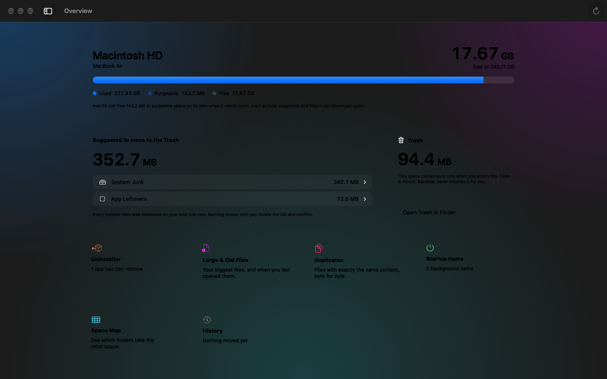

<p align="center">
  
</p>

<h1 align="center">BareMac</h1>

<p align="center"><b>The Mac cleaner that shows its work.</b><br>
Free and open source · macOS 14 or later · Apple silicon and Intel</p>

<p align="center">
  
</p>

BareMac shows you exactly what is taking space on your Mac, explains every item in
plain language, and lets you clean it safely. Every byte is measured, every path is
shown, and everything it moves can be put back.

## The safety contract

1. **Trash only.** BareMac never permanently deletes anything and never empties the Trash.
2. **Zero network.** No analytics, no update checks, no license checks — not a single connection.
3. **No privileges.** No helper tool, no `sudo`, nothing outside your own files.
4. **Measured bytes only.** Every size comes from measuring the files. No estimates, no "junk found" theater.
5. **Preview before action.** Nothing moves until you see the exact list and confirm. Every action is logged and can be restored.
6. **Allowlist discipline.** BareMac only touches well-known, safe locations. Anything uncertain is shown as information only.
7. **Honesty.** No "RAM booster", no fake optimization. If something can't be done safely and truthfully, it isn't in BareMac.

Each promise is enforced in code and proven by tests — see [How BareMac stays safe](docs/safety.md).

## What it does

| Module | What you get |
|--------|--------------|
| **Overview** | Total, used, free and purgeable space, plus what BareMac suggests moving — all measured live. |
| **System Junk** | Caches, logs and damaged settings in your Library; device backups (you pick); unused app languages (shown, never removed). |
| **App Leftovers** | Files left by apps you already removed, matched by app ID and shown with the app's name. |
| **Uninstaller** | Pick an app; see the app and every file it made; move them all to the Trash together. |
| **Large & Old Files** | Your biggest files with last-opened dates, kinds and Quick Look. |
| **Duplicates** | Byte-identical files (size → partial hash → full SHA-256). The newest copy always stays. |
| **Trash** | What's in your Trash and how much it holds. View only. |
| **Startup Items** | Background items in plain words, with on/off for your own via `launchctl`. |
| **Space Map** | A treemap of your biggest folders, so you see where space goes. |
| **History** | Every action BareMac took, with Put Back. |

## Install

**Download:** get the latest `BareMac-<version>.dmg` from
[Releases](https://github.com/iamirrf/BareMac/releases/latest), open it, and drag BareMac
to Applications. Releases are signed with a Developer ID and notarized by Apple.

**Homebrew:**

```bash
brew install --cask iamirrf/tap/baremac
```

## Build from source

Requirements: Xcode 26 or later (Swift 6.2+). The app runs on macOS 14 and later; Liquid
Glass appears on macOS 26 and later.

```bash
git clone https://github.com/iamirrf/BareMac.git
cd BareMac
swift test                      # runs every scanner, engine and safety test
Scripts/build-app.sh --adhoc    # builds dist/BareMac.app (ad-hoc signed)
Scripts/audit.sh dist/BareMac.app   # binary-level safety audit
open dist/BareMac.app
```

You can also open `Package.swift` in Xcode and run the `BareMac` scheme.

## BareMac vs CleanMyMac

|  | BareMac | CleanMyMac |
|--|---------|------------|
| Price | Free | Paid (see [comparison](docs/comparison.md) for current plans) |
| Source code | Open (MIT) | Closed |
| Telemetry | None — the app makes no network connections | See [comparison](docs/comparison.md) |
| What happens to removed files | Moved to the Trash; BareMac never empties it | See [comparison](docs/comparison.md) |
| Undo | Put Back from History or the Trash | See [comparison](docs/comparison.md) |

The full, sourced comparison — with the date it was checked — is in
[docs/comparison.md](docs/comparison.md).

## Documentation

- [How BareMac stays safe](docs/safety.md) — the contract, the code that keeps it, the tests that prove it
- [How each scanner decides what's safe](docs/scanners.md)
- [Architecture](docs/architecture.md)
- [Releasing](docs/release.md)
- [Contributing](CONTRIBUTING.md) · [Security](SECURITY.md) · [Code of conduct](CODE_OF_CONDUCT.md)

## License

MIT — see [LICENSE](LICENSE).
